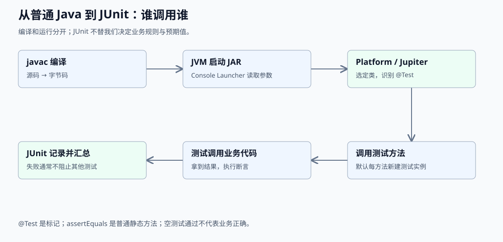
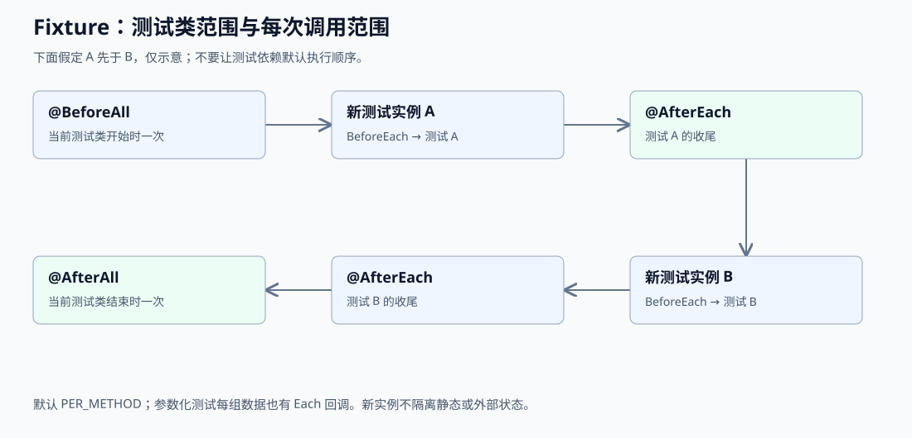
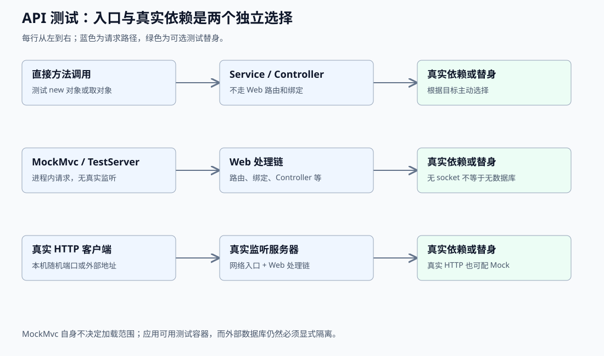
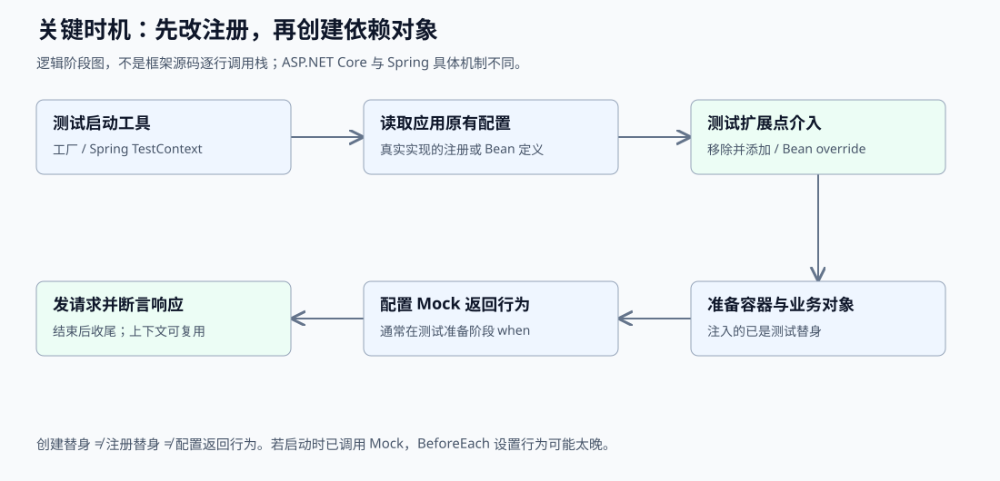

# Java 测试机制与 API 框架测试总结

整理日期：2026-11-17。整合原前两节总结、异常／条件／参数化测试讨论，以及 Spring Boot / ASP.NET Core API 测试扩展。本文是已讨论内容的机制总结，不等于所有示例都已运行或所有能力都已验证。

## 阅读导航与核心结论

从“普通 Java 方法怎么测”读到“框架如何接管应用初始化”。已有 DI 基础可直接跳到第六节；参数化写法困惑看第三节。

**没有额外的魔法：测试运行器组织调用；Web 测试支持组装应用；容器按测试规则提供依赖；业务代码按语言规则执行；测试作者决定检查什么。**

- 第一层：调用、断言与 JUnit 的职责。
- 第二层：Fixture、异常／条件／参数化测试。
- 第三层：API 测试的请求入口与覆盖边界。
- 第四层：初始化时怎样替换依赖，以及哪些东西没有自动隔离。

图解可直接在本文浏览，也可用[四页可编辑绘图源](测试机制图解.drawio)继续编辑。SVG 为独立预览，drawio 为对应结构源。

## 一、学习过程：先排除工具干扰，再看框架做了什么

学习起点是“知道少量单元测试概念，但不清楚具体怎样运行”。按用户要求，不使用 IDE，不先引入 Maven 或 Gradle。

先写 main 手动调用测试方法：调用业务方法、取得结果、用 if 检查，失败时 throw AssertionError。用户主动归纳：业务和测试都是遵守同一套规则的 Java 代码，职责不同。

然后在相同目录保留手动版本，增加 JUnit 独立 JAR 和无 main 的测试类，用 javac / java 编译运行。AI 实测两个测试通过；用户随后提供终端截图，同样是两个通过、零失败。

后续逐步拆清注解、断言、生命周期和参数来源。用户以“似乎没有魔法”和“类似 DSL”连接已有认知。Web API 扩展的真正缺口最终定位为：**既然 DI 在应用初始化时完成，测试怎样在这个阶段介入替换？** 而不是接口多态本身。

## 二、JUnit：入口、发现、调用与结果



### 2.1 谁编译，谁启动，谁调用

`javac` 把源码编译为字节码。编译期 `-cp` 让编译器找到 JUnit 注解、断言等类型。

`java -jar ...` 启动 JAR 中声明的命令行入口。Console Launcher 读取参数，Platform 协调发现与执行，Jupiter 引擎识别并执行我们写的 Jupiter 测试。

`--select-class CalculatorJUnitTest` 提供类名，不是源码；`--class-path out` 告诉 JUnit 到哪里加载测试与业务字节码。JUnit 不在这一步替我们编译源码。

测试类没有 main，不代表运行没有入口，而是入口来自 JUnit。JUnit 调用测试方法，**测试方法**再调用业务方法；框架不猜测应该调用哪个业务方法、传什么输入。

### 2.2 注解和断言不是同一件事

```java
/** 用 JUnit 检查一组加法结果。 */
@Test
void addsTwoNumbers() {
    int actual = Calculator.add(2, 3);
    assertEquals(5, actual);
}
```

`@Test` 是可被框架读取的标记，JVM 不会看到它就自动执行。`assertEquals` 来自 `org.junit.jupiter.api.Assertions`，是普通静态方法，不是 Java 关键字或 JDK 函数。静态导入只是让调用时省略类名。

当前整数例子可类比为 `if (actual != expected) throw ...`，这不是 JUnit 源码，也不意味着所有类型都按整数方式比较。预期在前，实际在后；对象判等、数组和浮点误差应选择合适的断言语义。

### 2.3 失败和报告

普通断言失败会使当前测试方法停止，JUnit 记录错误并通常继续执行其他测试，而不是像未捕获错误的手写 main 那样结束整个程序。它不是进程隔离：System.exit、JVM 崩溃等仍可能终止运行。

Console Launcher 在测试失败时返回非零退出码；`--fail-if-no-tests` 防止“没发现测试却看起来成功”。框架引擎或容器的 OK 不代表增加了业务测试数量，应看 tests 的计数。

**测试正常结束，只说明没有触发失败条件。空测试也能通过，错误的预期也会被照常执行。** 正确性来自需求与检查的质量，不来自绿灯本身。

## 三、Fixture 与教程其余常用能力

### 3.1 Fixture：准备条件与收尾，不是独立运行环境



Fixture 指测试所依赖的初始条件以及相关准备／收尾安排。教程计算器有累计状态，与本地静态 add 示例不同，独立测试要从明确状态开始。

| 注解 | 范围 | 用途与边界 |
| --- | --- | --- |
| BeforeEach | 每个测试调用前 | 准备对象与数据；参数化测试每组数据也有自己的调用 |
| AfterEach | 每个测试调用后 | 清理本次资源，普通断言失败时仍安排收尾 |
| BeforeAll | 当前测试类范围开始 | 统一准备一次，不是整个项目一次 |
| AfterAll | 当前测试类范围结束 | 统一释放一次，不保证每个测试重新获得干净状态 |

默认 PER_METHOD 生命周期中，每个测试方法使用新测试类实例。BeforeEach 中每次 new 业务对象，意味着**复用准备代码，不是复用那个对象**；同一方法内部的连续操作仍共享本次对象状态。

不同实例不自动隔离静态字段、外部数据库或共享引用；`calculator = null` 不等于关闭资源。没有资源清理需求时不用机械写 AfterEach。setUp / tearDown 的名字不是关键，注解才是框架约定。

默认模式下 BeforeAll / AfterAll 应为 static；显式使用 PER_CLASS 生命周期可使用实例方法。图示按顺序 A、B 展示不意味着 JUnit 默认保证该顺序。

### 3.2 异常测试与条件测试

用户自行阅读后自述容易理解，本轮不反复授课；这里只归纳用途，不声称已实际运行。

异常测试把“应该抛出特定异常”作为预期，例如 `assertThrows(IllegalArgumentException.class, () -> ...)`：把待执行操作交给断言方法，由它执行并检查异常，而不是先执行完再传结果。预期异常出现可视为测试成功；未抛或抛出不匹配异常则失败。必要时还要检查异常信息或操作后的状态。

条件测试决定特定条件下是否执行，例如操作系统或运行环境。**跳过不是通过，也不是已经验证该环境行为。** 条件应有业务／平台理由，不能靠跳过掩盖故障。

### 3.3 参数化：同一个测试方法，多组参数独立调用

```java
/** 每一行数据形成一次独立的加法检查。 */
@ParameterizedTest
@CsvSource({"2, 3, 5", "7, 0, 7", "-2, 3, 1"})
void checkAdd(int a, int b, int expected) {
    assertEquals(expected, Calculator.add(a, b));
}
```

这不是替换 Java 传参规则，而是 JUnit 解析每行数据，按**位置和参数类型**形成 `checkAdd(2, 3, 5)` 等调用。参数名不决定列匹配；第三列也不是框架天然知道的预期，是测试方法在断言中赋予其用途。

| 数据源 | 看成什么 | 易混点 |
| --- | --- | --- |
| ValueSource | 一列简单输入 | 每个值形成一次调用，不是把整组列表交给参数 |
| CsvSource | 代码中的多列表格 | 每个字符串一行，逗号分列，再转换为形参类型 |
| MethodSource | 调用另一个方法取得参数组 | 提供数据的方法不是测试本身 |
| CsvFileSource | classpath 内的 CSV 资源 | javac 不自动将资源复制到 out |

为避免教程同名重载带来的绕感，优先显式写数据方法名：

```java
/** 使用数据方法提供的每组参数检查加法。 */
@ParameterizedTest
@MethodSource("addCases")
void checkAdd(int a, int b, int expected) {
    assertEquals(expected, Calculator.add(a, b));
}

/** 返回多组测试参数，不执行加法或断言。 */
static List<Arguments> addCases() {
    return List.of(
        Arguments.of(2, 3, 5),
        Arguments.of(7, 0, 7)
    );
}
```

省略 MethodSource 的名字时，JUnit 按约定找同名提供方法；这不是 Java 自动调用重载。`Arguments.of` 包装一次调用的参数，不是自动推断正确答案。上面片段省略 imports，不能当作完整独立程序；没有写入或运行本地参数化实验。

JUnit 的注解与 API 可以类比嵌入 Java 的测试 DSL，但注解只是声明，真正解析、调用和记录的是 JUnit 程序。

## 四、从方法测试到 Web API：差别首先在入口



先把两个维度分开：**请求从哪里进入**与**依赖用真实还是替身**。真实 HTTP 不等于真实数据库；无网络请求也不等于没有真实外部调用。

| 方式 | 实际覆盖 | 没有据此验证 |
| --- | --- | --- |
| 直接调用 Service | 输入到业务输出及选定依赖交互 | Web 路由、绑定、过滤器、JSON、服务器 |
| 直接调用 Controller | Controller 方法本身 | 不自动执行完整 Web 请求链与其验证过程 |
| Spring MockMvc | 使用 mock Servlet API 驱动真实 DispatcherServlet 和 MVC 链 | 真实 Servlet 容器与 socket、TLS、反向代理 |
| ASP.NET Core TestServer | 进程内请求驱动应用管线与端点 | 真实 Kestrel socket、TLS、部署代理行为 |
| RANDOM_PORT 等真实服务器测试 | 真实监听端口及 HTTP 处理 | 正式部署拓扑与全部外部依赖正确性 |

MockMvc 自身不决定应用加载范围：`@WebMvcTest` 通常是 MVC 切片，`@SpringBootTest` 配合 `@AutoConfigureMockMvc` 可加载更完整上下文但仍不启动真实监听。SpringBootTest 默认 MOCK；RANDOM_PORT 才启动真实嵌入服务器，通常仍在测试 JVM 内，不自动另起一台机器或进程。

WebApplicationFactory 默认使用 TestServer。它创建的 HttpClient 可通过内存中的处理器将请求交给测试宿主，因此看到 HttpClient 或 `https://localhost` 不代表真监听或真 TLS。也可以配置其他服务器模式，不能说此工厂永远无网络。

这些测试常属于切片或集成测试；不能只因使用 JUnit 就统称单元测试。覆盖范围取决于真实参与的组件与入口，而不是测试方法上的框架品牌。

## 五、工具分工：不是换掉 JUnit

| 层次 | Java 常见工具 | .NET 常见工具 | 职责 |
| --- | --- | --- | --- |
| 运行器与测试组织 | JUnit Platform / Jupiter | xUnit、NUnit、MSTest | 调用测试，记录和汇总 |
| 应用测试支持 | Spring TestContext、Boot 测试支持 | WebApplicationFactory | 准备测试应用、接入启动配置 |
| 请求入口 | MockMvc 或真实 HTTP 客户端 | TestServer 的客户端或真实 HTTP | 驱动指定范围的请求链 |
| 替身构造 | 手写 Fake、Mockito | 手写 Fake、Moq 等 | 提供可控行为对象 |
| 装配机制 | Spring Bean 容器 | IServiceCollection / DI 容器 | 按配置连接真实对象或替身 |

JUnit 自己不会自动创建完整 Spring 应用，也不会自动替换数据库。Spring 测试支持通过扩展机制与 JUnit 协作；.NET 的结构类似，但没有必要引入 JUnit。

## 六、最关键的时序：测试怎样介入原应用的初始化



### 6.1 不是请求中途换对象，而是容器组装前介入

用户已经知道 DI，不需要重新证明“接口可以注入另一个实现”。真正问题是原应用已写了真实实现注册，测试何时能改变它。

**注册信息、可用容器、已创建的业务对象不是同一个阶段。** 正常应用先声明注册，再构建／刷新容器，再创建业务对象。测试启动工具掌握这次应用启动，利用配置回调或 Bean 覆盖扩展点，在依赖对象完成创建之前加入替换规则。

“在关键步骤拦截并替换”可作为概括，但更准确是使用框架公开的生命周期扩展点，不是任意改写进程，也不是 HTTP 请求自带修改 DI 的能力。

### 6.2 ASP.NET Core：修改用于构建宿主的服务注册

以下为机制片段，不是已执行过的独立完整项目。假设接口、实现、Program 可见性及测试包引用已满足：

```csharp
using var factory = new WebApplicationFactory<Program>()
    .WithWebHostBuilder(builder =>
    {
        builder.ConfigureTestServices(services =>
        {
            // 原应用服务注册后，删除目标注册，再加测试实现。
            services.RemoveAll<IUserRepository>();
            services.AddScoped<IUserRepository, FakeUserRepository>();
        });
    });

// 工厂在需要客户端／服务时准备或使用测试宿主。
using var client = factory.CreateClient();
var response = await client.GetAsync("/users/42");
```

ConfigureTestServices 的回调在应用服务注册之后、最终服务提供程序构建之前调整 IServiceCollection。WithWebHostBuilder 创建定制工厂，不是把原工厂已运行的宿主热改掉。CreateClient 通常触发宿主准备，之后可以复用。

只追加同接口注册不等于完全删除旧注册：单服务解析通常取最后注册，而 `IEnumerable<T>` 仍可包含多个注册。显式移除再添加较清楚；EF 等组件可能有多项关联注册，要按具体版本和配置处理，不是只删除一个接口就保证全部数据库设施隔离。

若启动代码提前自行 BuildServiceProvider 或手动 new 并持有对象，这些对象可能不受后续标准注册覆盖影响，应回到实际启动路径检查。

### 6.3 Spring：在测试上下文准备阶段覆盖 Bean

当前 Spring 测试可使用 `@MockitoBean`；较早 Spring Boot 示例常见 `@MockBean`。必须按项目实际 Spring / Boot 版本选择，不要求为本笔记升级项目。

```java
@SpringBootTest
class UserApiTest {
    @MockitoBean
    UserRepository repository;

    /** 测试执行前，在已经注入应用的 Mock 上设置行为。 */
    @BeforeEach
    void prepareResponse() {
        when(repository.findName(42L)).thenReturn("小明");
    }
}
```

Spring 测试支持先收集测试配置，准备测试 ApplicationContext；Bean 覆盖基础设施在上下文准备过程中处理目标定义和替身，使随后创建的业务 Bean 注入 Mock。不是 JUnit 在测试方法开始后扫描所有既有对象并强改字段。

`@MockitoBean` 默认可以替换或新建目标；希望必须匹配现有 Bean 时可使用 enforceOverride，多个候选时需名称或 Qualifier 消歧。仅写 Mockito 的 `@Mock` 只创建普通替身，不自动替换 Spring 容器。不同版本对 Bean 作用域限制不同，不能无版本地泛化所有覆盖行为。

### 6.4 三个容易混在一起的动作

1. **创建替身**：手写 Fake，或 mock 工具生成对象。
2. **将替身装入应用**：改服务注册／Bean 覆盖，使业务对象引用它。
3. **设置替身行为**：when(...).thenReturn(...) 决定这个对象收到调用时返回什么。

业务对象可以先持有 Mock，再配置它的返回规则，不必重新注入。但如果业务 Bean 在构造或初始化时就调用它，BeforeEach 才设行为可能太晚；需要更早准备行为或调整初始化设计。

容器无法靠普通注册替换控制业务内部写死的 `new DatabaseUserRepository()`。Mock 工具生成对象可能涉及代理／字节码，这与容器选择注入谁是两个不同机制。

## 七、环境与隔离：不要把测试宿主当成结界

**测试应用实例不等于隔离进程；隔离进程不等于隔离数据库；真实 HTTP 不等于所有依赖都真实。**

| 被隔离的对象 | 典型措施 | 不自动保证什么 |
| --- | --- | --- |
| 测试类实例字段 | JUnit 默认每方法新实例 | 静态变量、外部状态、共享对象 |
| 应用依赖关系 | 测试注册、Bean 覆盖 | 所有真实连接都被替换、初始化完全无副作用 |
| 数据库数据 | 专用库／schema、测试容器、显式清理 | 不同测试无并发干扰、事务跨 HTTP 自动传播 |
| 外部 HTTP／消息 | 替身、stub server、专用测试服务 | 后台任务和未替换客户端不会真发送 |
| 网络与服务器 | TestServer / MockMvc 或专用监听端口 | 正式 TLS、网关、负载均衡和部署配置 |

Spring TestContext 可按配置缓存并复用上下文，不是每个测试方法都重启应用；相同配置的测试类也可能共享上下文，单例业务状态可能遗留。WebApplicationFactory 的宿主是否复用也取决于工厂生命周期。框架清理 Mock 行为，不等于回滚所有业务或外部状态。

真实 HTTP 中客户端测试与服务端请求通常分线程、分事务。测试方法上的 Transactional 不会自动包住服务器线程中的数据库操作，不能只凭测试结束回滚就认为服务端数据一定清掉。

若仅用客户端访问已经独立启动的外部 API，客户端不能更改远端容器 DI；需要由服务端以测试配置启动，或在外部依赖入口采用专用测试服务等方案。

## 八、用目标判断测试价值，不追求“尽可能模拟”

| 想验证什么 | 合理的入口与依赖选择 |
| --- | --- |
| 用户存在／不存在时业务分支是否正确 | 直接调用业务服务，用可控 Repository 替身 |
| URL、绑定、JSON、异常响应是否符合约定 | Web 入口测试，按目标保留真实 MVC／应用组件 |
| SQL、映射、约束或事务是否正确 | 真实数据访问实现 + 专用测试数据库 |
| 真服务器与 HTTP 集成是否正常 | 真实监听端口及客户端 |
| 部署后网关、TLS、认证链是否正常 | 专门的部署环境验证，不能仅靠进程内测试 |

用 Repository Mock 的成功，只能支持“上层在约定数据返回时行为正确”，不能证明 SQL 正确，也不能证明 Mock 描述的行为真的与数据库一致。Mock 太多会使测试变成“验证自己写的假设”，应为被替换边界保留适当的真实集成验证。

## 九、当前学习证据和本地实验

- 普通 Java 与 JUnit 运行主干：有用户主动解释；用户按给定命令运行两个测试通过，有终端截图证据。
- Fixture：已讲解，尚未运行独立生命周期实验。
- 异常／条件测试：用户自行阅读，自述容易理解；不是本轮独立实验验证。
- 参数化测试：从写法困惑到自述理解，并用 DSL 类比解释；未运行参数化实验。
- API 测试：已讲解请求入口、容器组装、替身注入时机；用户概括关键步骤介入替换并表示明白。未搭建 Web 项目，未验证实际配置能力，也不知道用户历史项目采用哪种模式。

没有因为资料覆盖而判定全部掌握；没有将尚未执行的失败实验变成必须完成的作业。接下来按实际疑问继续。

现有代码：[业务类](../examples/03-unit-test/Calculator.java)、[手动测试](../examples/03-unit-test/CalculatorTest.java)、[JUnit 测试类](../examples/03-unit-test/CalculatorJUnitTest.java)、[命令行运行说明](../examples/03-unit-test/运行说明.md)。

固定依赖是 Platform Console Standalone 1.14.1（包含 Jupiter 5.14.1），本机 JDK 17；不宣称它是最新版。仓库默认忽略 JAR 与 class，克隆后按运行说明下载固定依赖，不提交生成字节码。

## 十、来源与版本边界

教程用于覆盖检查；框架细节以实际版本的官方文档为准。本文新增深度梳理不是对用户历史项目的现场诊断。

- [廖雪峰：单元测试章节](https://liaoxuefeng.com/books/java/unit-test/index.html)
- [Fixture](https://liaoxuefeng.com/books/java/unit-test/fixture/index.html)、[异常测试](https://liaoxuefeng.com/books/java/unit-test/exception-test/index.html)、[条件测试](https://liaoxuefeng.com/books/java/unit-test/conditional-test/index.html)、[参数化测试](https://liaoxuefeng.com/books/java/unit-test/parameterized-test/index.html)
- [JUnit 5.14.1 Console Launcher](https://docs.junit.org/5.14.1/running-tests/console-launcher.html)
- [Spring MockMvc 概述](https://docs.spring.io/spring-framework/reference/testing/mockmvc/overview.html)
- [Spring Boot 测试与 Web 环境](https://docs.spring.io/spring-boot/reference/testing/spring-boot-applications.html)
- [Spring MockitoBean](https://docs.spring.io/spring-framework/reference/testing/annotations/integration-spring/annotation-mockitobean.html)
- [Spring 测试上下文缓存](https://docs.spring.io/spring-framework/reference/testing/testcontext-framework/ctx-management/caching.html)
- [ASP.NET Core 集成测试、工厂与服务配置](https://learn.microsoft.com/en-us/aspnet/core/test/integration-tests?view=aspnetcore-10.0)
- [ASP.NET Core TestServer](https://learn.microsoft.com/en-us/aspnet/core/test/middleware?view=aspnetcore-10.0)

Spring 在线 current 与 .NET 10 文档用于核对核心机制，不保证所有注解／API 在旧项目中可用；项目落地时先核对框架版本。上述 Web 片段只说明机制，不以未运行代码充当验证证据。
