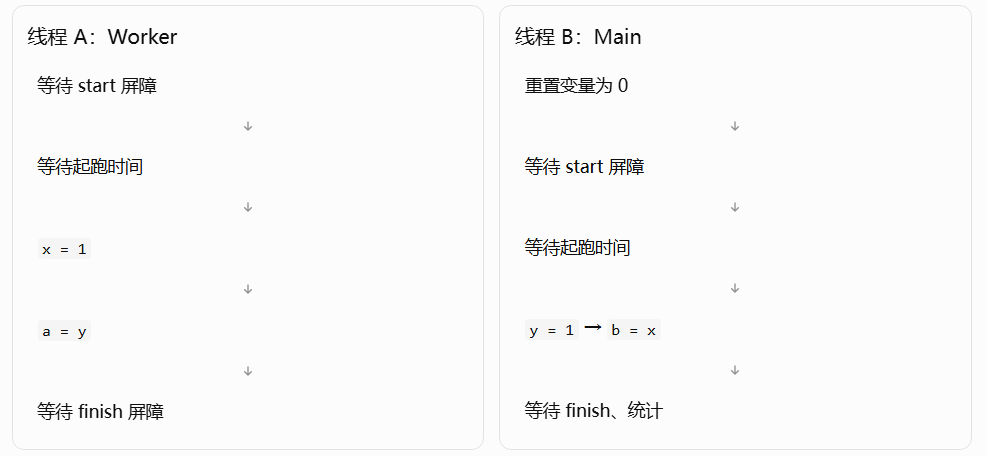
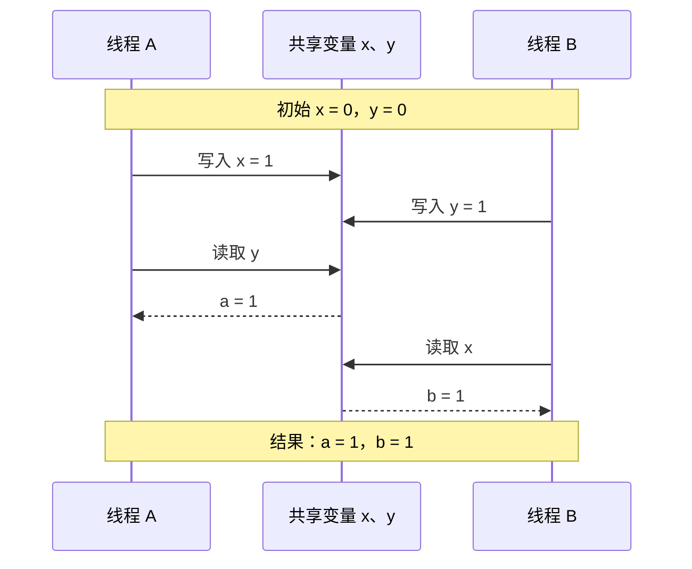
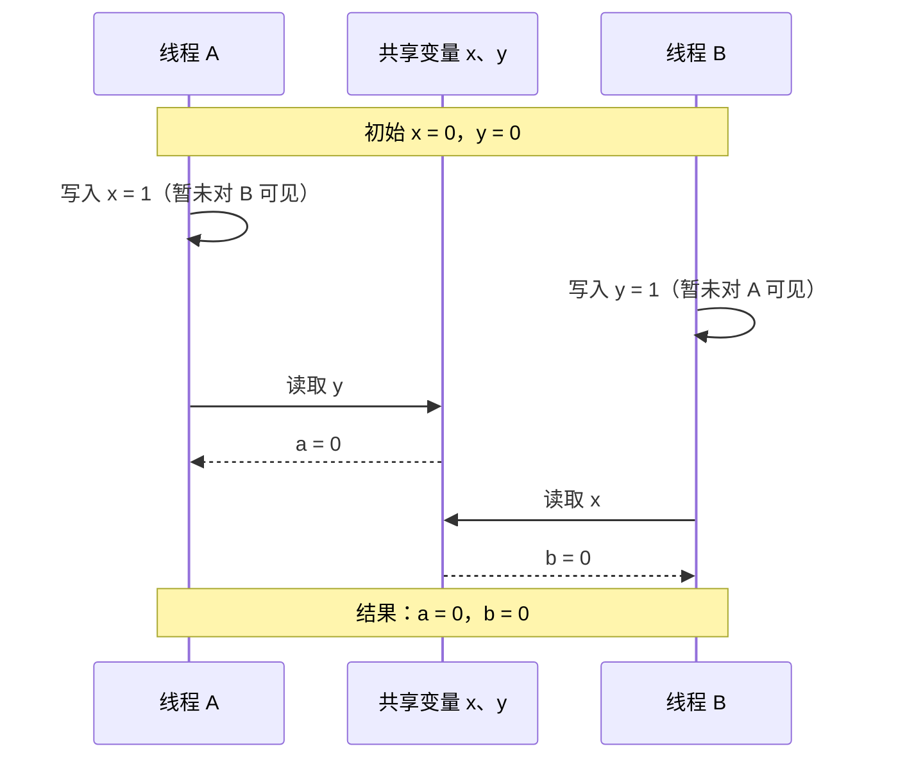
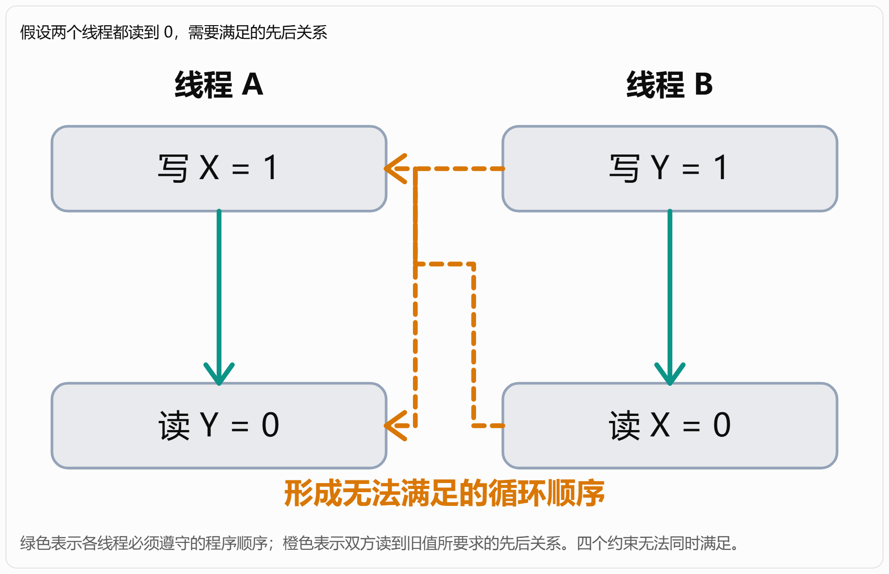

## `volatile`

示例参考*[VolatileReadComparison](Java\examples\05-thread-safety\VolatileReadComparison.java)*



## **1. 正常时序：双方都读取到 1**



## **2. 异常时序：不使用 volatile，双方都读取到 0**



### **加上 volatile 后，究竟保证了什么？**

先看定义：

```
private volatile int volatileX;
private volatile int volatileY;
```

`volatile` 修饰的是**字段**，不是线程，也不是代码块。

你的两条执行路线变为：

**线程 A**

```
volatileX = 1;
a = volatileY;
```

**线程 B**

```
volatileY = 1;
b = volatileX;
```

Java 对 `volatile` 有两项重要保证：

**第一，volatile 读写必须遵守统一的同步顺序。**

所有 `volatile` 读写都参与一个全局的同步顺序，这个顺序必须与每个线程自身的程序顺序一致。

**第二，对同一个 volatile 变量的写入，可以与之后的读取建立 happens-before 关系。**

这使得写入之前的其他内存操作，也能按照规则被读取方观察到。

现在你的实验就不能出现双方同时读到 0 了。

为什么？

假设 A、B 都读到 0，就意味着：

* A 读取 `volatileY` 时，必须排在 B 写入 `volatileY = 1` 之前。
* B 读取 `volatileX` 时，必须排在 A 写入 `volatileX = 1` 之前。

但各线程自身又必须保持写后读的顺序。



## **四、但 volatile 不保证谁先运行**

这点特别重要。

即使使用 `volatile`，你的代码仍然可能出现以下三种结果：

| 实际交错顺序                         | a | b |
| ------------------------------------ | - | - |
| A 写 X → B 写 Y → A 读 Y → B 读 X | 1 | 1 |
| A 写 X → A 读 Y → B 写 Y → B 读 X | 0 | 1 |
| B 写 Y → B 读 X → A 写 X → A 读 Y | 1 | 0 |

它**不保证两个线程按照某个固定顺序执行，也不保证两个读取值都是 1**。

它保证的是这些 `volatile` 读写必须符合 Java 内存模型规定的顺序关系，因此不能出现 `a=0、b=0`。


## **五、volatile 的保证范围到底有多大？**

| 作用                                                     | `volatile`能否保证 |
| -------------------------------------------------------- | -------------------- |
| 被修饰字段的读写可见性与顺序规则                         | 能                   |
| 写入前的普通变量修改，在对应同步关系建立后被另一线程看到 | 能                   |
| 多个 volatile 读写满足统一同步顺序                       | 能                   |
| 固定线程 A、B 谁先运行                                   | 不能                 |
| 保证整个线程的所有操作都不可交错                         | 不能                 |
| 保证 `count++`原子执行                                 | 不能                 |

例如：

```
int data = 0;
volatile boolean ready = false;
```

线程 A：

```
data = 100;
ready = true;
```

线程 B：

```
if (ready) {
    System.out.println(data);
}
```

如果 B 读取到了 A 写入的 `ready == true`，那么根据 happens-before 规则，它也必须观察到 A 之前写入的 `data = 100`（假设没有其他线程修改 `data`）。

这就是为什么**仅仅给** `ready` **加上** `volatile`**，也能保护这个特定的跨线程数据发布关系**。

## **最后把这段代码重新理解一遍**

你这个实验其实有三层不同的顺序：

1. **线程自身的程序顺序**：A 先写 X 再读 Y；B 先写 Y 再读 X。
2. **屏障建立的顺序**：初始化必须发生在核心实验之前，统计必须发生在双方完成之后。
3. **volatile 建立的内存顺序**：对 `volatileX`、`volatileY` 的读写必须遵循统一的同步顺序。

`volatile` **主要约束第三层，不负责线程调度，也不替代** `CyclicBarrier`**。**

你现在最需要区分的是：**代码的执行顺序、线程的调度顺序、其他线程观察内存修改的顺序，是三个不同的概念。** 多线程中很多看似奇怪的现象，都来自把这三者误认为是一回事。
