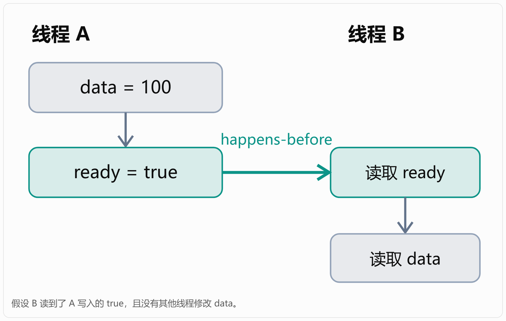

`happens-before` **可以简单理解为：Java 规定的一种跨线程执行顺序和数据可见性保证。**

它要解决的问题是：

> 线程 A 做完了一件事，凭什么保证线程 B 能看到 A 做过的修改？

## **一、先看没有 happens-before 的情况**

线程 A：

```
data = 100;
ready = true;
```

线程 B：

```
if (ready) {
    System.out.println(data);
}
```

虽然 A 先写了 `data`，再写了 `ready`，但如果它们都是普通字段，B 即使看到了 `ready == true`，也不保证能读到 `data == 100`。

因为**A 自己的执行顺序，不代表 B 一定能按这个顺序观察到结果。**

## **二、happens-before 做了什么？**

只需要修改一个地方：

```
int data = 0;
volatile boolean ready = false;
```



假设 B 读到了 A 写入的 true，且没有其他线程修改 data。

Java 规定：

1. A 中，`data = 100` happens-before `ready = true`（程序顺序规则）。
2. A 对 `ready` 的 volatile 写入 happens-before B 随后的 volatile 读取（同步规则）。
3. B 读取 `ready` happens-before B 读取 `data`（程序顺序规则）。

**happens-before 具有传递性。**

所以最终得到：

`data = 100` happens-before B 读取 `data`。

这就保证 B 能读到 100。

## **三、最容易误解的一点**

**happens-before 不是单纯表示现实时间上的“先发生”。**

例如 A 在上午 10:00 写入普通变量，B 在上午 10:01 读取。

虽然现实时间过去了一分钟，但如果缺少必要的同步，Java 内存模型仍然不保证 B 一定读到 A 写入的值。

因此：

* **时间先后**：A 实际上比 B 更早执行。
* **happens-before**：Java 保证 A 的操作结果按照规定对 B 可见，并约束相关操作的顺序。

两者并不等价。

## **四、它和锁有什么关系？**

happens-before 并不是 `volatile` 独有的。

Java 还提供了其他建立这种关系的方式：

| 场景               | happens-before 关系                             |
| ------------------ | ----------------------------------------------- |
| 普通单线程代码     | 前面的操作先于后面的操作                        |
| `volatile`       | 对同一变量的写入先于同步顺序中后续的读取        |
| `synchronized`   | 一个线程释放锁先于另一个线程随后获取同一把锁    |
| `Thread.start()` | 调用 `start()`之前的操作先于新线程中的操作    |
| `Thread.join()`  | 被等待线程的操作先于成功 `join()`返回后的操作 |

这些机制让 Java 程序能够可靠地进行跨线程协作。

**最后记住一句话就够了：**

> `happens-before` 不是在描述 CPU 实际先执行了什么，而是在规定两个操作之间必须满足怎样的内存可见性和顺序保证。

以后看到 `volatile`、`synchronized`、线程启动或等待结束，你就可以问：**它们在两个线程之间建立了什么 happens-before 关系？**

这样理解就够用了，不需要现在去背 Java 内存模型的全部规则。


对，**happens-before 是一个跨语言的并发理论概念，并不是 Java 独有的。**

它最早来自分布式系统领域，用来描述事件之间的因果顺序关系，后来也被用于多线程内存模型。

不过，不同领域对它的具体定义和用途有所区别。

| 领域       | happens-before 的作用                                      |
| ---------- | ---------------------------------------------------------- |
| 分布式系统 | 描述不同节点上事件之间的因果先后关系                       |
| Java       | 规定线程间的内存可见性与顺序保证                           |
| C++        | 在内存模型中定义操作间的顺序关系，帮助判断并发程序的正确性 |
| Rust       | 通过原子操作、同步机制等建立跨线程的顺序与可见性保证       |

**共同的核心思想是：不能仅凭现实时间或代码书写顺序，就推断不同执行主体之间存在可靠的先后关系。必须有明确的规则建立这种关系。**

例如，两个线程通过锁协调，两个分布式节点通过消息传递建立因果关系，本质上都在解决“怎样确定不同执行主体之间的顺序”这个问题。

但要注意，分布式系统中的 happens-before 主要表示因果关系；Java 内存模型中的 happens-before 则具有明确的内存可见性约束，不能完全等同。

所以你可以把它放在更大的知识框架里：

**并发理论 → 内存模型与同步规则 → Java 的** `volatile`**、**`synchronized` **等具体实现。**

这样以后学习 C#、C++ 或分布式系统时，这部分认识依然能够复用。

[(10 封私信) 深入理解 C++ happens-before：高级并发程序员的必修课 - 知乎](https://zhuanlan.zhihu.com/p/1963928065760527921)

[(10 封私信) happens-before是什么？JMM最最核心的概念，看完你就懂了 - 知乎](https://zhuanlan.zhihu.com/p/126275344)

[Go通道：理解Happens-Before，保证并发安全 - InfoQ](https://www.infoq.cn/article/NSIGgSs0jS3ZCPvo84YD)
