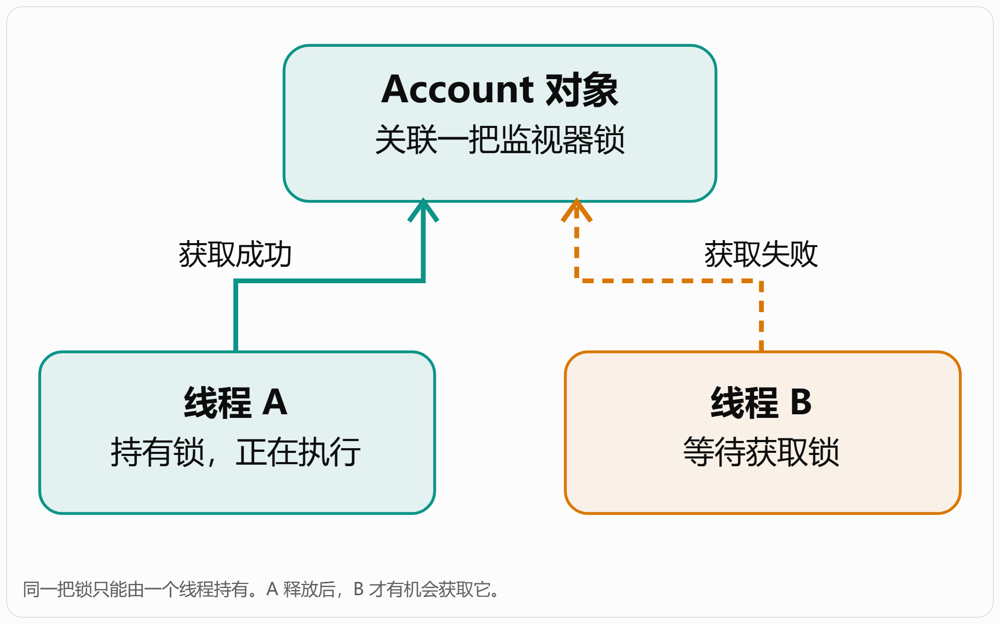
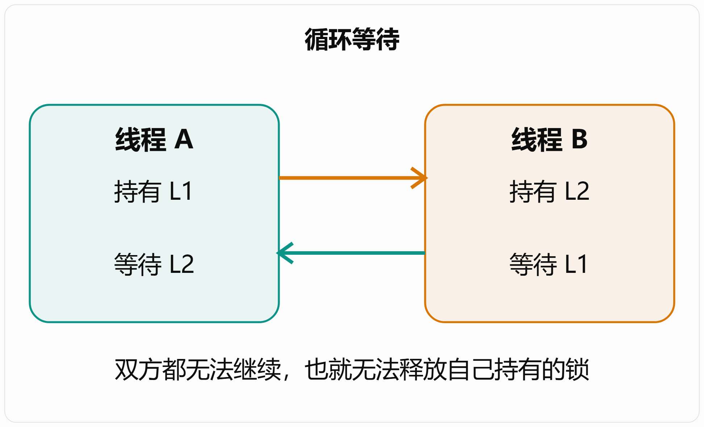
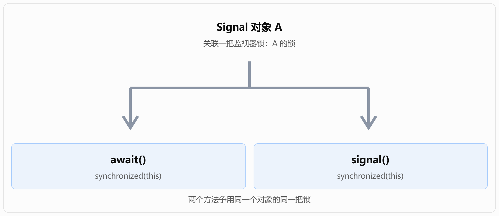

## **先从** `synchronized` **的核心矛盾开始**

假设两个线程同时执行：

```
count++;
```

你已经知道，这个操作可以拆成读取、加一、写回，两个线程交错执行可能造成更新丢失。

那么最直接的解决办法就是：

**一个线程正在修改** `count` **时，暂时不允许另一个线程执行同一组修改操作。**

Java 提供了 `synchronized`：

```
private int count = 0;

public synchronized void increment() {
    count++;
}
```

这样，多个线程调用**同一个对象**的 `increment()` 方法时，必须竞争同一把锁，同一时刻最多一个线程能够进入方法执行。

但这又引出了三个值得深入的问题：

1. `synchronized` 锁住的是变量、代码，还是对象？
2. 线程拿不到锁时会发生什么？会不会一直占用 CPU？
3. 为什么加锁不仅能防止修改冲突，还能保证内存可见性？

其中第三个问题正好能把你刚学的 `happens-before` 联系起来。

**建议我们就从这三个问题展开。** 暂时不需要研究锁优化、对象头、Monitor 的底层实现。先理解锁的行为、保证和使用边界，再进入 Java 的并发工具。

我们继续学习 `synchronized`。

前面我们已经弄清楚：多个线程可能同时访问共享数据，`volatile` 可以建立可见性和顺序保证，但不能阻止多个线程互相干扰。

这一部分我们要解决的是：

**Java 如何让多个线程安全地修改共享数据？它为什么能做到？又要付出什么代价？**

## **一、为什么需要锁？**

我们先用一个账户余额的例子。

假设账户里有 100 元，两个线程同时尝试取出 80 元。

```
class Account {
    private int balance = 100;

    public void withdraw(int amount) {
        if (balance >= amount) {
            balance -= amount;
        }
    }
}
```

如果两个线程同时调用 `withdraw(80)`，可能出现这样的过程：

没有加锁时的执行过程

| 时刻 | 线程 A        | 线程 B        |
| ---- | ------------- | ------------- |
| 1    | 读取余额 100  | —            |
| 2    | —            | 读取余额 100  |
| 3    | 判断可以取 80 | —            |
| 4    | —            | 判断可以取 80 |
| 5    | 余额减去 80   | —            |
| 6    | —            | 余额再减去 80 |

可能的最终余额

# **-60 元**

假设两个线程都通过余额检查，并且两次扣款先后生效。也可能发生更新覆盖，产生其他错误结果。

问题不只是 `balance -= amount` 这个操作，而是：

**余额检查和余额扣减必须作为一个整体，不能被其他取款操作插入。**

这个整体就叫作*临界区（Critical Section）*。

我们给它加上 `synchronized`：

```
class Account {
    private int balance = 100;

    public synchronized void withdraw(int amount) {
        if (balance >= amount) {
            balance -= amount;
        }
    }
}
```

现在，两个线程对同一个 `Account` 对象调用这个方法时，就不能同时进入方法执行。

第一个线程检查并扣款完成后，第二个线程才能进入。第二个线程看到余额为 20，不会再次扣款。

这就是**互斥（Mutual Exclusion）**。

## **二、**`synchronized` **锁住的究竟是什么？**

这是理解 Java 锁最重要的一点。

`synchronized` **使用的是与对象关联的监视器锁（Monitor Lock），而不是直接锁住某个变量或一段代码。**

`synchronized` 修饰的是**实例方法**，锁关联的是 `this`（当前对象），而不是方法本身。

例如：

```
Account account = new Account();

Thread a = new Thread(() -> account.withdraw(80));
Thread b = new Thread(() -> account.withdraw(80));

a.start();
b.start();
```



这两个线程调用的是同一个 `account` 对象的同步方法，因此竞争的是同一把锁。

同一把锁只能由一个线程持有。A 释放后，B 才有机会获取它。

这有一个非常实际的后果：**如果两个线程使用不同对象的锁，就无法互相保护。**

看下面这段代码：

```
Account accountA = new Account();
Account accountB = new Account();
```

`accountA` 和 `accountB` 是两个不同对象，各自有自己的监视器锁。

因此，一个线程调用 `accountA.withdraw()`，另一个线程调用 `accountB.withdraw()`，它们不需要互相等待。

这很合理，因为两个账户通常可以独立操作。

但如果两个对象实际操作的是同一份外部共享数据，那么只锁各自的对象就不一定安全了。

### `synchronized` **的两种常用写法**

第一种，锁整个实例方法：

```
public synchronized void withdraw(int amount) {
    // ...
}
```

相当于：

```
public void withdraw(int amount) {
    synchronized (this) {
        // ...
    }
}
```

第二种，指定一个专门的锁对象：

```
private final Object lock = new Object();

public void withdraw(int amount) {
    synchronized (lock) {
        // ...
    }
}
```

后一种可以更明确地控制哪些代码需要使用同一把锁，也避免将对象自身的锁暴露给外部调用者。

这里先记住两个规则：

* 同一个对象上的 `synchronized` 实例方法，默认使用同一把锁。
* 不同对象的锁彼此独立。`static synchronized` 使用的是对应的 `Class` 对象锁，与实例锁不同。

## **三、拿不到锁的线程在干什么？**

这个问题可以直接联系到我们前面学的操作系统线程调度。

假设线程 A 已经获取锁，正在执行：

```
synchronized (lock) {
    // 操作共享数据
}
```

此时线程 B 也想获取 `lock`。

会发生什么？

**1. 线程 A 获取锁**

A 进入临界区。只要它还持有锁，其他线程就不能同时获取该锁。

**2. 线程 B 尝试获取锁失败**

B 需要等待。Java 平台线程在锁竞争时可能经过短暂自旋等优化；进入阻塞等待后，它就不再持续占用 CPU 执行自己的 Java 代码。

**3. 线程 A 释放锁**

A 正常离开 `synchronized` 块时释放锁。即使执行过程中抛出异常，也会在退出同步块时释放锁。

**4. 线程 B 获得执行机会**

B 可以继续竞争锁；成功获取后，才能进入临界区。具体由哪个等待线程先获得锁，并没有公平性保证。

因此，你之前建立的操作系统认识仍然适用。

**等待锁和等待数据库都是线程暂时无法继续执行的情况，但等待的条件不同。**

需要特别注意：持有锁的线程可能正在运行，也可能因为其他原因被操作系统切走。操作系统把它切走，并不意味着它自动释放 Java 锁。

## **四、为什么** `synchronized` **还能保证可见性？**

这是它和 `volatile` 之间最重要的联系。

前面已经认识了 `happens-before`，现在可以直接应用。

假设两个线程使用同一把锁：

```
private final Object lock = new Object();
private int data = 0;
```

线程 A：

```
synchronized (lock) {
    data = 100;
}
```

线程 B：

```
synchronized (lock) {
    System.out.println(data);
}
```

如果 A 先完成同步块并释放锁，B 随后获取同一把锁，那么 Java 保证：

**A 释放锁之前的操作 happens-before B 成功获取该锁之后的操作。**

所以，假设没有其他线程修改 `data`，B 会读到 100。

这就是 `synchronized` 同时提供的两种保证：

| 保证           | 如何实现                                             |
| -------------- | ---------------------------------------------------- |
| 互斥           | 同一时刻只有一个线程持有同一把锁                     |
| 可见性与有序性 | 释放锁与随后获取同一把锁之间建立 happens-before 关系 |

这里还有一个很容易踩的坑。

假设线程 A 这样写：

```
synchronized (lock) {
    data = 100;
}
```

但线程 B 这样读取：

```
System.out.println(data);
```

B 根本没有获取 `lock`。

那么仅凭 A 加过锁，不能保证 B 一定观察到 100。

**加锁不是让变量永久获得线程安全属性，而是让遵守相同同步规则的代码能够正确协作。**

## **五、加锁有什么代价？**

既然 `synchronized` 能解决共享数据竞争，我们是不是应该给所有方法加锁？

当然不是。

假设有一个订单处理方法：

```
public synchronized void processOrder() {
    checkOrder();
    queryDatabase();
    callRemoteService();
    saveOrder();
}
```

如果多个线程对同一个对象调用这个方法，那么第一个线程执行期间，其他线程可能都要等待同一把锁。

即使第一个线程正在等待数据库或者远程服务，它也仍然持有锁。

这就可能造成：

* 其他线程长时间等待，吞吐量下降。
* 原本能够并发的工作被串行化。
* 如果多个锁之间相互等待，还可能发生死锁。

所以锁的核心设计问题是：**哪些操作必须作为一个整体执行？这些操作需要共用哪一把锁？**

例如账户余额检查和扣减需要保持一致，但某个耗时的远程查询是否也必须在锁内执行，就需要根据业务约束判断。

还有一个相关概念叫**可重入锁**：Java 的 `synchronized` 是可重入的。同一个线程持有某个对象的锁时，可以再次进入使用同一把锁的同步方法，不会因此把自己阻塞住。

## **六、目前先建立这个认识**

我们不需要立刻深入 Monitor 的底层实现。到这里，已经能够解释 `synchronized` 的主要行为。

| 问题                   | `synchronized`的答案                             |
| ---------------------- | -------------------------------------------------- |
| 为什么能防止修改冲突？ | 同一把锁保护的临界区不能被多个线程同时执行         |
| 锁住的是什么？         | 对象关联的监视器锁                                 |
| 拿不到锁怎么办？       | 等待锁可用，不保证马上获得                         |
| 为什么保证可见性？     | 同一把锁的释放与后续获取建立 happens-before        |
| 有什么限制？           | 相关访问必须遵守同步规则，并且锁竞争会降低并发能力 |


**锁能保证共享数据不被同时修改，但不能保证多个线程一定能够顺利完成工作。**

这就涉及两个相关问题：

* **死锁（Deadlock）**：多个线程互相等待，谁也无法继续。
* **线程协作**：一个线程需要等待另一个线程完成某件事，怎样正确通知和恢复执行？

我们先从死锁开始，因为它能直接使用你刚学的知识来解释。

## **一、死锁为什么会发生？**

你已经知道，线程获取 `synchronized` 锁以后，其他线程必须等它释放锁。

但如果一个操作需要两把锁呢？

假设有两个线程 A、B，以及两把锁 L1、L2。




**线程因等待另一把锁而阻塞时，不会自动释放自己已经持有的锁。**

因此，两个线程可能都没有占用 CPU 持续计算，但程序就是无法继续执行。

这就是死锁。

**二、怎么避免死锁**

**统一加锁顺序。**


前面死锁的根源在于：

```
线程 A：先 L1，后 L2
线程 B：先 L2，后 L1
```

如果改成：

```
线程 A：先 L1，后 L2
线程 B：先 L1，后 L2
```

结果就不同了。

因为 A、B 必须先竞争 L1。

假设 A 先获得 L1，B 就只能在外面等待。此时 B 还没有获得 L2，因此 A 可以继续获得 L2，完成工作，再释放两把锁。

```
// 线程 A
synchronized (lock1) {
    synchronized (lock2) {
        // ...
    }
}

// 线程 B
synchronized (lock1) {
    synchronized (lock2) {
        // ...
    }
}
```

**统一的全局锁获取顺序，可以避免由这些锁形成的循环等待。**

真实开发中，两个账户之间转账就是典型场景：如果每次先锁转出账户，再锁转入账户，那么 A→B 和 B→A 两笔转账并发执行时，就可能死锁。采用稳定的账户顺序获取锁，可以避免这种情况。

这里不需要死记死锁的全部必要条件。理解“持有一把锁，又等待其他线程手里的锁，最后形成等待闭环”，就足够解释大多数简单死锁问题。

**死锁是错误的依赖关系，正常的线程协作是有明确解除条件的等待。**

## **三、线程协作：等待不一定是错误**

接下来有一个容易混淆的问题。

我们前面一直在讲，线程等待锁可能产生死锁。

但实际业务中，**线程等待另一个线程完成工作，本身非常正常。**

例如：

一个线程负责接收消息，另一个线程负责处理消息。

```
生产者线程：接收消息 → 放入队列
消费者线程：从队列取消息 → 处理消息
```

当队列没有消息时，消费者该怎么办？

一种方法是不停检查：

```
while (queue.isEmpty()) {
    // 一直检查
}
```

但这种忙等待会浪费 CPU，而且如果没有正确同步，还会有可见性问题。

更合理的方案是：

1. 消费者发现没有数据，进入等待。
2. 生产者放入一条消息。
3. 生产者通知消费者。
4. 消费者恢复执行，检查并取出消息。

这叫做**线程间的条件协调**。

### `wait()` **和** `notifyAll()` **如何完成协作？**

Java 的每个对象都支持监视器等待与通知机制。

看一个最小示例：

`synchronized` 修饰的是**实例方法**，锁关联的是 `this`（当前对象），而不是方法本身。

**是同一把监视器锁。** 前提是这两个方法属于同一个对象实例。



```
class Signal {
    private boolean ready = false;

    public synchronized void await()
            throws InterruptedException {
        while (!ready) {
            wait();
        }
        System.out.println("收到信号");
    }

    public synchronized void signal() {
        ready = true;
        notifyAll();
    }
}
```

这里有一个你需要特别留意的地方：

//**wait() 的作用：等待时主动释放锁**

如果没有wait而是空循环的话


1. A 先进入 `await()`，获取了 `Signal` 对象的锁。
2. A 发现 `ready == false`，于是一直循环。
3. B 想进入 `signal()`，却发现锁在 A 手上。
4. B 进不去，就无法修改 `ready`。
5. A 永远等不到 `ready == true`。

`wait()` **会释放当前对象的监视器锁，**`synchronized` **本身的锁竞争等待则不会释放线程已持有的其他锁。**

当线程 A 执行 `await()` 时：

* 它先持有 `Signal` 对象的锁。
* 发现 `ready == false`，执行 `wait()`。
* `wait()` 释放当前 `Signal` 对象的锁，进入等待。
* 线程 B 因此可以进入 `signal()`，修改 `ready` 并调用 `notifyAll()`。
* A 被通知后，还需要重新获取该对象的锁，然后才能继续执行。

注意，`notifyAll()` 并不会立即把锁交给 A。B 仍要先退出同步方法，释放锁。

而 `while (!ready)` 不是随便写的。线程被唤醒后，条件可能已变化，也可能发生虚假唤醒，因此必须重新检查条件。


## **四、等待锁、等待条件，有什么不同？**

这是当前最值得建立的区别。

| 情况                       | 线程在等什么                   | 关键行为                             |
| -------------------------- | ------------------------------ | ------------------------------------ |
| `synchronized`获取锁失败 | 其他线程释放锁                 | 等待获得进入临界区的资格             |
| `Object.wait()`          | 某个条件得到通知或其他唤醒原因 | 释放当前对象锁，等待后重新获取       |
| `Thread.sleep()`         | 指定时间经过                   | 让线程暂停，但不会自动释放已持有的锁 |
| `Thread.join()`          | 目标线程终止                   | 当前线程等待另一个线程完成           |

你会发现，Java 的线程协作其实并不神秘：

**线程需要知道什么时候应该停止工作、等待什么，以及满足什么条件才能继续。**

而操作系统调度、监视器锁、线程通知等机制，负责支撑这些行为。
