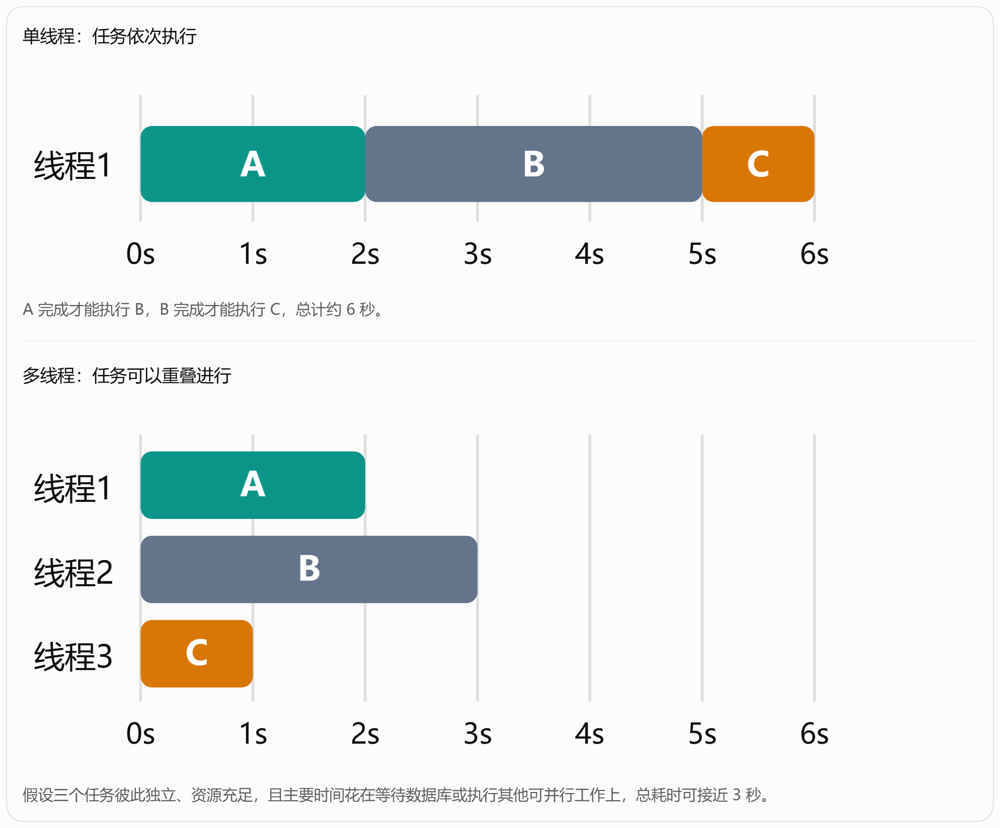
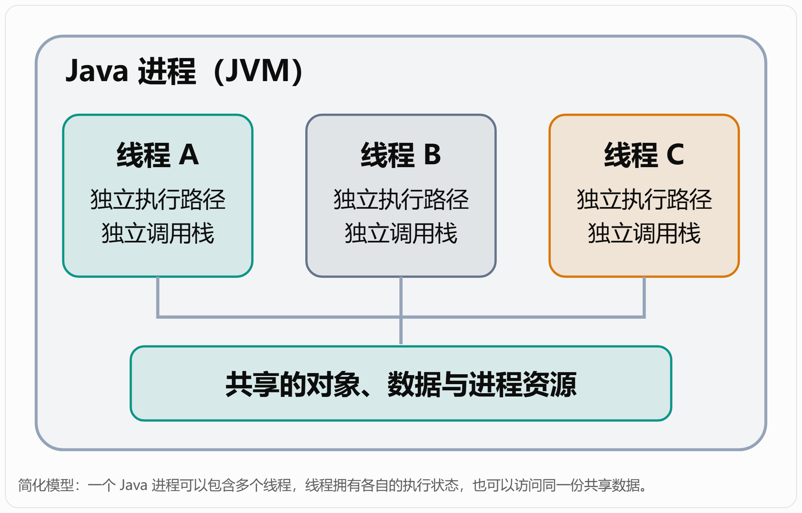
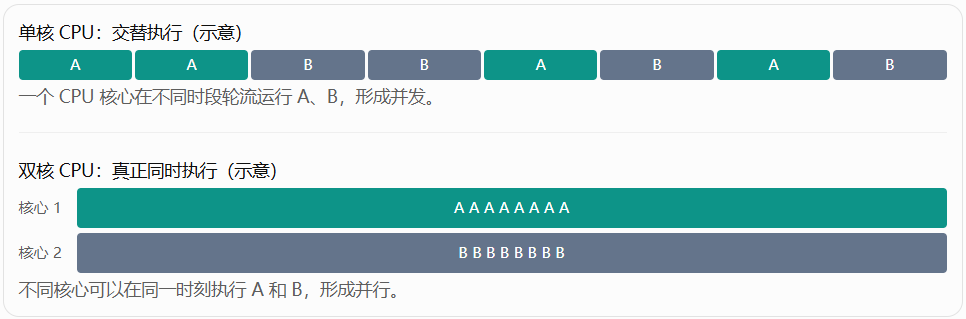
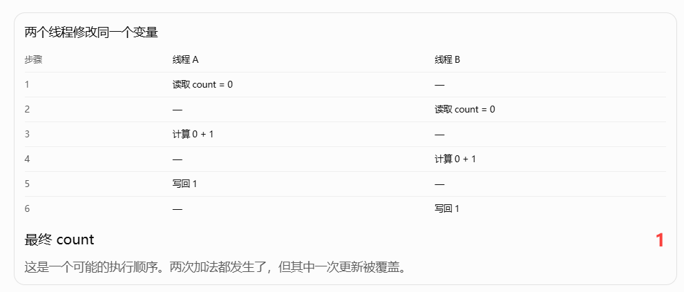
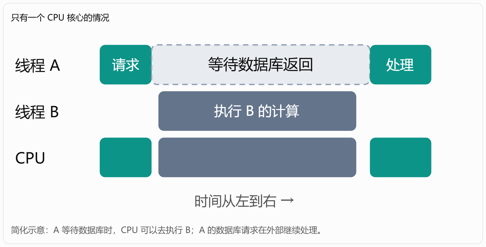
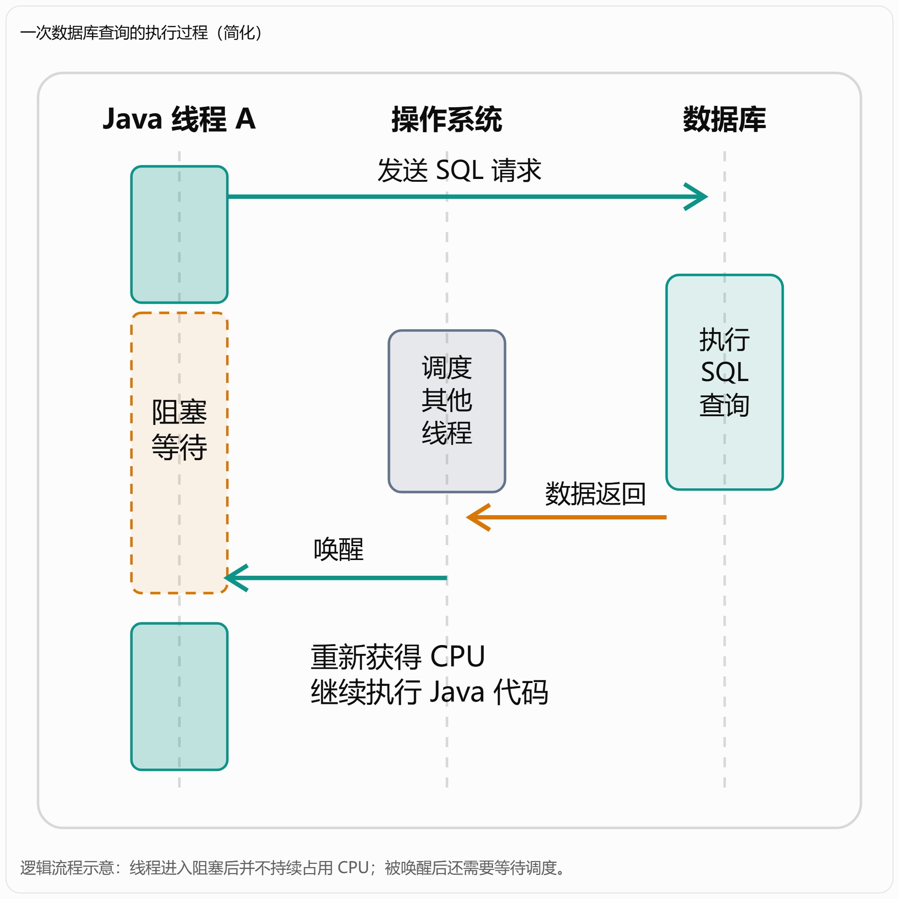
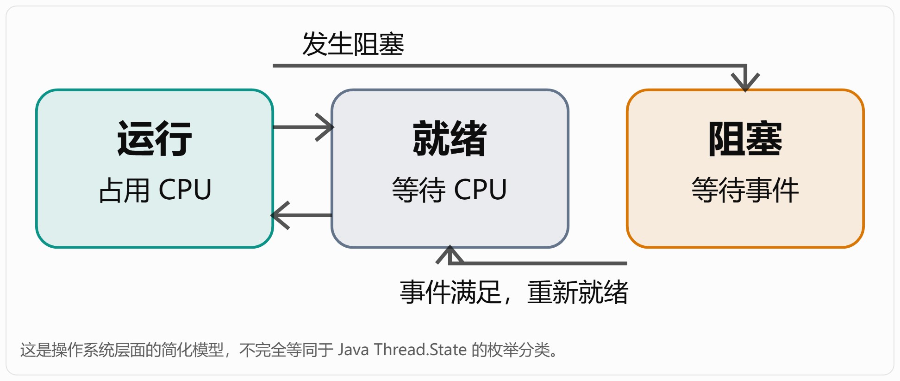
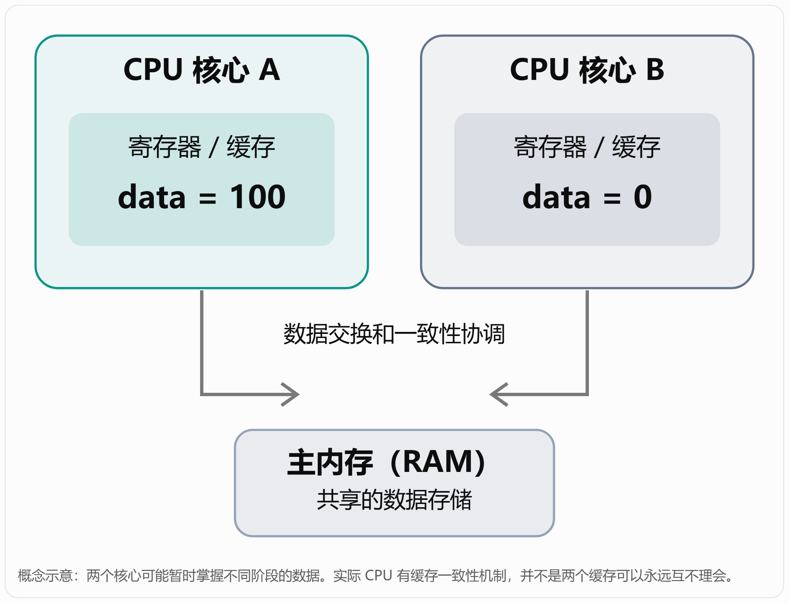

在前端（JavaScript）里，你早就处理过“同时做多件事”：发网络请求时页面不会卡死、定时器到点会触发回调。但 JS 默认是**单线程**的——它靠 **Event Loop（事件循环）+ 异步** 把“等待网络/IO”的时间让出来，本质上还是**一个执行者**在来回切换。

这套模式在前端很好用，但到了后端或计算密集型场景，会撞上两堵墙：

1. **一做重活就全盘卡死**：如果在 JS 主线程里跑一个耗时 3 秒的大循环或图像压缩，整个页面会彻底冻住，因为没有第二个执行者去响应点击。
2. **浪费多核 CPU**：现在的电脑和服务器动辄 8 核、16 核，单线程同一时刻最多只能用掉 **1 个核**，剩下 7 个核都在干瞪眼。

**多线程（Multithreading）** 就是为了打破这两堵墙：让一个程序内部同时拥有多个独立的执行流，真正把多核 CPU 跑满，或者在一个线程被卡住（比如等数据库返回）时，其他线程照常干活。

### 先建立一个最简物理模型：进程、线程与共享内存

不需要背操作系统教材的定义，用“厨房”就能看清核心关系：

* **进程（Process）= 一间独立的厨房**：你启动一个 Java 程序（或打开一个浏览器标签页），操作系统会给它分配一块独立的内存空间。厨房之间互相隔离，默认不能随便拿对方的东西。
* **线程（Thread）= 厨房里的厨师**：真正执行代码的人。
* **多线程 = 同一个厨房里，同时有好几个厨师在干活**。

这里藏着整个多线程领域**最核心、也是所有麻烦的根源**：**同一个进程里的多个线程，共享同一块内存**（共用同一间厨房的食材、锅和账本）。

### 多线程到底在学什么？四个核心问题（全景图）

你贴的廖雪峰 Java 多线程教程目录看起来名词很多（`synchronized`、死锁、`wait/notify`、线程池、`CompletableFuture` 等），但它们并不是零散的知识点，而是围绕“既要多个人一起干活提速，又不能把共享的东西搞乱”这一对核心矛盾长出来的 4 块拼图：

#### 1. 怎么让多个线程跑起来、怎么切换？（调度与生命周期）

* **机制**：创建线程后，并不是你决定谁先跑、跑多久，而是由**操作系统**不断在线程之间高速切换（哪怕只有 1 个 CPU 核，快速轮流切也能让你感觉在“同时跑”）。
* **前端直觉在这里会失效**：在 JS 里，一段同步函数一旦开始执行，一定会从头跑到尾，中途**不会被别的同步代码插队**。但在 Java 多线程里，操作系统采用的是**抢占式调度**——你的代码执行到一半（甚至一行 `i++` 执行到一半），随时可能被暂停、切给另一个线程。**你无法预测两个线程谁先跑完。**

#### 2. 怎么防止大家把共享数据改乱？（线程安全与锁）

* **现象**：两个厨师同时看了一眼库存本写着“剩 1 份牛肉”，于是两人都接了单，结果库存扣成了 `-1`。在代码里，多个线程同时读写同一个变量，就会出现结果随机出错的现象（**竞态条件**）。
* **机制**：为了解决冲突，必须立规矩——最常见的是**加锁**（Java 里的 `synchronized`、`ReentrantLock`），规定“同一时刻只允许一个线程进门改账本，其他人门口排队”。另一种思路是干脆**不共享**（比如 `ThreadLocal` 给每个线程发一份自己的副本，或者把数据做成不可变的）。
* **代价与边界**：锁加得越粗、越多，大家排队越严重，程序就越慢，极端情况下会退化成单线程；如果规矩设计不好，还会出现**死锁**（厨师 A 拿着锅等 B 给铲子，B 拿着铲子等 A 给锅，谁也动不了）。

#### 3. 线程之间怎么打配合？（通信与协作）

* **现象**：光靠锁只能“互相防着不撞车”，但很多业务需要线程接力——比如线程 A 负责收订单，线程 B 负责做菜。如果没订单，线程 B 一直死循环问“有单了吗？”会白白烧光 CPU。
* **机制**：需要一套“叫醒机制”（如 `wait/notify`、阻塞队列）：没活干时线程 B 主动去睡觉（释放 CPU），线程 A 收到订单后把它叫醒。

#### 4. 怎么省着点用线程？（工程化：线程池与异步编排）

* **边界**：线程不是免费的。每创建一个线程都要向操作系统申请内存，线程太多时，操作系统光顾着在它们之间来回切换（上下文切换），真正干活的时间反而变少了。如果服务器来 1 万个请求就 `new` 1 万个线程，程序会直接崩溃。
* **机制**：实际工程中很少手动创建线程，而是用**线程池**——提前雇好固定数量（比如 20 个）的厨师，来任务就放进队列排队，谁闲着谁接手，复用线程。再往上层，Java 提供了 `Future` / `CompletableFuture` 来编排多个异步任务的先后和合并——**这部分和前端的 `Promise` / `Promise.all` 思想非常接近**。

### 和前端（JS）做个对照，划清边界

| **维度**                          | **前端 JS（单线程 + Event Loop）** | **Java 多线程**                    |
| --------------------------------------- | ---------------------------------------- | ---------------------------------------- |
| **并发方式**                      | 1 个人通过异步回调错峰干活               | 多个人同时干活，可利用多核 CPU           |
| **代码会不会被中途打断**          | 同步代码块不会（协作式）                 | 随时可能被操作系统切走（抢占式）         |
| **共享数据冲突**                  | 极少遇到（同一时刻只有一段代码在改变量） | **核心痛点**，必须考虑线程安全与锁 |
| **遇到耗时操作（如读文件/查库）** | 必须异步，否则卡死全局                   | 可以直接同步阻塞当前线程，其他线程照常跑 |
| **最擅长场景**                    | 高频 I/O 等待、UI 交互                   | 多核 CPU 密集计算、高并发后端请求处理    |

### 多线程解决的是什么问题



### **进程、线程、CPU 是什么关系**

当你运行一个普通的 Java 应用时，操作系统会创建一个进程。这个进程中运行着 JVM，JVM 负责执行 Java 代码。

而**线程是这个进程内部实际执行代码的执行单元**。



几个非常重要的关系。

**1. 进程是资源和运行环境的边界。**

例如两个独立运行的 Java 程序，通常是两个进程。它们默认不会直接共享彼此的内存。

**2. 线程是执行代码的单位。**

线程有自己的执行位置、调用栈等状态。Java 程序启动时就有执行 `main()` 的主线程，还可以创建其他线程。

docs.oracle.com+1

**3. 同一进程的线程可以共享数据。**

比如线程 A 和线程 B 都访问某个 Java 对象。这很方便，但也意味着它们可能相互干扰。

### **CPU 是怎么执行多个线程的？**

这就需要先区分两个容易混淆的概念：

* **并发（Concurrency）**：多个任务在同一段时间内交替或重叠推进。
* **并行（Parallelism）**：多个任务在同一个时刻真正同时执行。



传统 Java 平台线程通常由操作系统线程承载，操作系统负责调度它们使用 CPU。

所以，**创建两个线程，不意味着 CPU 就会自动增加一倍的计算能力。**

如果两个任务都在拼命进行数学计算，那么性能取决于可用 CPU 核心、调度和资源争用等因素。

但如果线程 A 正在等待数据库返回结果，CPU 此时未必需要为 A 做什么计算，它就有机会处理线程 B。

这就引出了多线程的重要价值：不仅能利用多个 CPU 核心，也能让程序在等待外部资源时继续处理其他事情。


我们写一段最简单的程序。

```

public class Main {
    public static void main(String[] args) throws InterruptedException {
        System.out.println("主线程开始");

        Thread worker = new Thread(() -> {
            System.out.println("子线程开始");
            System.out.println("子线程工作结束");
        });

        worker.start();

        System.out.println("主线程继续工作");

        worker.join();

        System.out.println("全部结束");
    }
}
```

只需要认识三个地方：

`new Thread(...)` 创建一个新的线程对象，并指定它要执行的任务。

`worker.start()` 启动线程，使其有机会被调度执行。**它不会要求主线程等这个任务完成。**

`worker.join()` 则让当前主线程等待 `worker` 执行结束，再继续往下执行。

你可能看到这样的输出：

```
主线程开始
主线程继续工作
子线程开始
子线程工作结束
全部结束
```

也可能是：

经过测试 大多数情况不按照这个情况走走但是有按照这个顺序走的可能性？手动测试未复现改情况。但是在 ``worker.start();``后加上 ``Thread.sleep(1);``就可以出现

```
主线程开始
子线程开始
子线程工作结束
主线程继续工作
全部结束
```

这两种结果都是允许的。

因为两个线程之间并没有规定谁先打印中间的内容。`join()` 只保证主线程打印“全部结束”之前，子线程已经结束。

**这就是多线程编程区别于普通顺序编程的一个关键特征：不同线程之间的执行顺序，不能随便假定。**

### 多线程和异步

**异步和多线程都能处理任务等待问题，但它们不是同一个概念。**

浏览器页面中的普通 JavaScript 通常在主线程上执行。`await` 一个尚未完成的 Promise 时，当前异步函数暂停，主线程可以去执行其他工作，而不是为这个函数创建一个新的 JavaScript 线程。

Java 的传统阻塞式编程则可以让一个线程等待 I/O，同时由其他线程处理新任务。

两者不是互斥的：Java 也能实现异步非阻塞 I/O，JavaScript 运行环境也能使用工作线程。

因此，**线程解决的是执行路径与调度问题，异步解决的是任务如何组织等待与后续处理的问题。**

### 多线程竞态



### 线程与CPU与操作系统

**线程占着一个执行位置，不代表它一直占用 CPU。**



| 任务类型                             | 单核多线程的效果                 |
| ------------------------------------ | -------------------------------- |
| CPU 密集型（大量数学计算）           | 通常没有加速，可能更慢           |
| I/O 密集型（数据库、网络、文件等待） | 可以提高任务处理效率             |
| 混合型                               | 取决于计算、等待以及线程管理开销 |

注意，多线程不会让一次数据库查询本身变快，而是让程序在等待期间还能处理其他工作。

**线程占着一个执行位置，不代表它一直占用 CPU。**



### 二、关键问题：操作系统怎么知道线程需要等待？

这个问题的核心在于 **系统调用（System Call）**。

Java 程序不能随意直接操作网卡等硬件。通常需要通过操作系统提供的接口完成网络通信。

对于常见的阻塞式数据库查询，过程大致如下：

1. JDBC 驱动通过网络连接向数据库发送请求。
2. 驱动尝试从网络连接读取响应。
3. 如果数据还没有到达，底层阻塞式读取操作就无法完成。
4. 操作系统将对应线程置于不可运行的等待状态，并调度其他线程。

注意第三步。

**不是线程不断询问数据库“好了吗、好了吗”，而是它向操作系统请求读取数据，操作系统发现暂时没有数据，于是安排它等待。**

这就叫阻塞式 I/O。

当然也有另一种方式：程序不停检查数据是否到达，这叫轮询（Polling）。如果采用忙轮询，确实会持续消耗 CPU，但这不是传统阻塞式 JDBC 等待结果的典型做法。

### 三、数据库返回结果后，线程怎么恢复？

这就涉及操作系统和硬件之间的协作。

假设数据库在另一台服务器上。

**1. 数据库完成查询，发送响应**

结果通过网络传输，抵达 Java 服务所在机器的网卡。

**2. 网卡和操作系统处理收到的数据**

硬件可以通过中断等机制通知操作系统有数据需要处理。操作系统网络协议栈接收并处理网络数据。

**3. 操作系统唤醒等待的线程**

当网络连接有数据可读取，操作系统可以唤醒等待该条件的线程，使其重新具备运行资格。

**4. CPU 重新执行 Java 线程**

操作系统调度器选择这个线程运行，恢复它需要的执行上下文。底层读取操作返回，JDBC 继续解析响应，最终把查询结果交给 Java 代码。

这里有个特别容易误解的地方：

**唤醒不等于马上执行。**

例如操作系统已经知道线程 A 可以继续执行了，但 CPU 还在运行线程 B。

这时线程 A 可以先进入就绪状态，等待操作系统将 CPU 分配给它。

另外，一次数据库响应可能分成多个网络数据包。因此，线程被唤醒并不一定表示整个 SQL 查询已经完成，它可能还需要继续读取，甚至再次阻塞。

### **线程被阻塞时，究竟保存了什么？**

**上下文切换（Context Switch）**。


线程运行时，处理器和操作系统需要维护一些执行信息，例如：

* 当前执行到哪条机器指令。
* CPU 寄存器中的值。
* 当前线程的调用栈和栈指针。
* 与线程调度有关的状态。

线程被切走时，操作系统需要保存必要的执行上下文。之后再次运行时，恢复相应上下文，就能继续执行，而不必从 `main()` 开始重新运行。

但也要注意：线程的调用栈并不是每次切换都要完整复制一份。通常它仍保存在内存中，切换主要涉及必要的处理器状态和调度工作。

这也是线程切换为什么有成本，却不至于每次都重新运行整个程序的原因。


| 概念           | 它负责什么                           |
| -------------- | ------------------------------------ |
| CPU            | 真正执行机器指令                     |
| 操作系统调度器 | 决定哪些线程获得 CPU                 |
| 线程           | 保存一条执行路径及其运行状态         |
| 系统调用       | 程序请求操作系统执行受保护的操作     |
| 阻塞           | 线程暂时无法继续执行，等待条件满足   |
| 唤醒           | 等待条件出现后，允许线程重新参与调度 |
| 上下文切换     | 保存、恢复执行状态以切换运行的线程   |


**多线程有上下文切换开销，但当任务包含大量等待时，调度其他线程带来的收益可能远大于切换成本。**

我们还需要保留一个边界：今天讲的是传统 Java 平台线程与阻塞式 I/O 的简化工作方式。Java NIO、异步 I/O 和虚拟线程可以改变任务等待与底层线程的对应关系，但不改变 CPU、操作系统、网络设备之间的基本协作原理。

**操作系统决定哪个可运行线程获得 CPU，而线程是否具备运行条件，还取决于它正在执行什么、等待什么。**




### 多线程的错误冲突（全景第二步 线程安全与锁）


| 你的理解                        | 更准确的表述                                   | 典型现象                                   |
| ------------------------------- | ---------------------------------------------- | ------------------------------------------ |
| 1. 同一内存冲突                 | 多线程访问共享数据时，操作可能相互干扰         | 两个线程执行 `count++`，发生更新丢失     |
| 2. CPU 缓存同步带来的时序问题   | CPU 缓存、写缓冲、内存顺序等机制影响跨线程观察 | 一个线程的写入，另一个线程未必按预期观察到 |
| 3. JVM 和编译器带来的预期外编译 | JVM/JIT 在 Java 内存模型允许的范围内进行优化   | 循环中的普通变量读取可能被提到循环外       |

其中第二点需要特别注意：**现代 CPU 通常有缓存一致性机制，但缓存一致性不等于所有内存操作都具有程序员预期的执行顺序。**

第三点也不是编译器编错了，而是程序没有建立必要的同步关系，导致编译器有权进行这些优化。

| 问题       | 核心疑问                               |
| ---------- | -------------------------------------- |
| 原子性     | 一组操作能否被其他线程干扰？           |
| 可见性     | 一个线程的修改，其他线程能否及时看到？ |
| 有序性     | 不同线程观察到的操作顺序是否符合要求？ |
| 状态一致性 | 多个变量组合后，能否保持业务约束？     |

#### 原子性问题

一个逻辑操作由多个步骤组成，中途可能被其他线程干扰。如改同一份内存

#### A 修改完成，B 却可能看不到

假设我们有两个共享变量：

```
int data = 0;
boolean ready = false;
```

线程 A：

```
data = 100;
ready = true;
```

线程 B：

```
if (ready) {
    System.out.println(data);
}
```

按单线程的直觉，如果 B 发现 `ready == true`，说明 A 已经写入 `data = 100`。

但在 Java 内存模型下，**如果没有适当的线程同步，B 可能看到** `ready == true`**，却仍然读到旧的** `data = 0`**。**

为什么？

因为 CPU、缓存、编译器优化和 Java 内存模型共同决定了不同线程能观察到什么。一个线程中的普通变量写入，并不自动保证另一个线程按相同顺序观察到这些写入。

这涉及两个概念：

* **可见性**：A 修改的数据，B 什么时候能够观察到？
* **有序性**：A 按顺序执行的操作，B 是否一定按这个顺序观察到？

这比单纯的修改覆盖更深一层。

不过也不要误解成 CPU 会任意乱执行代码。Java 有明确的内存模型规则，合理同步之后就可以建立线程之间的可见性与顺序保证。




| 存储位置             | 特点                               |
| -------------------- | ---------------------------------- |
| CPU 寄存器           | 离执行单元最近，速度极快，容量很小 |
| CPU 缓存（L1/L2/L3） | 存放最近使用的数据，速度快         |
| 主内存（RAM）        | 容量大，但访问更慢                 |

因此，CPU 执行 `data = 100` 时，并不意味着它必须立即把 100 写入物理内存，然后让所有核心都重新读取。

写入可以经过缓存、写缓冲等机制，而处理器还会协调不同核心观察数据的顺序。

**程序中的一次变量写入，并不等于全计算机立即完成一次统一的数据更新。**

**线程 A 自己的执行顺序，不自动等于线程 B 能观察到的顺序。**

除了 CPU 缓存，还有另一层因素：Java 编译器和 JVM 的优化。


例如，编译器可能调整互不依赖的内存操作，CPU 也可能使用乱序执行、写缓冲等机制。

在不破坏单线程语义的前提下，这些优化通常是允许的。

如果两个线程之间没有建立正确的同步关系，Java 就不会保证 B 看到 `ready == true` 时，一定也能看到之前写入的 `data = 100`。这是 Java 内存模型（JMM）规定的行为边界。

Oracle Docs+1

需要强调：这个结果是 Java 内存模型允许的，不代表任何 CPU 都会按图中缓存变化的方式产生它。缓存只是帮助我们理解的第一层模型。

#### **每次读取都正确，组合起来却错误**


假设某个对象表示一个坐标：

```
class Position {
    int x = 0;
    int y = 0;
}
```

线程 A 想将坐标从 `(0, 0)` 更新为 `(100, 100)`：

```
position.x = 100;
position.y = 100;
```

线程 B 在中间读取：

```
int x = position.x;
int y = position.y;
```

它可能得到 `(100, 0)`。

这里没有发生修改覆盖。两个变量的值也都是各自真实存在过的值，但**组合起来不是业务允许的完整状态**。

这属于复合操作的一致性问题。仅仅保证单个变量的读取和写入正确还不够。
