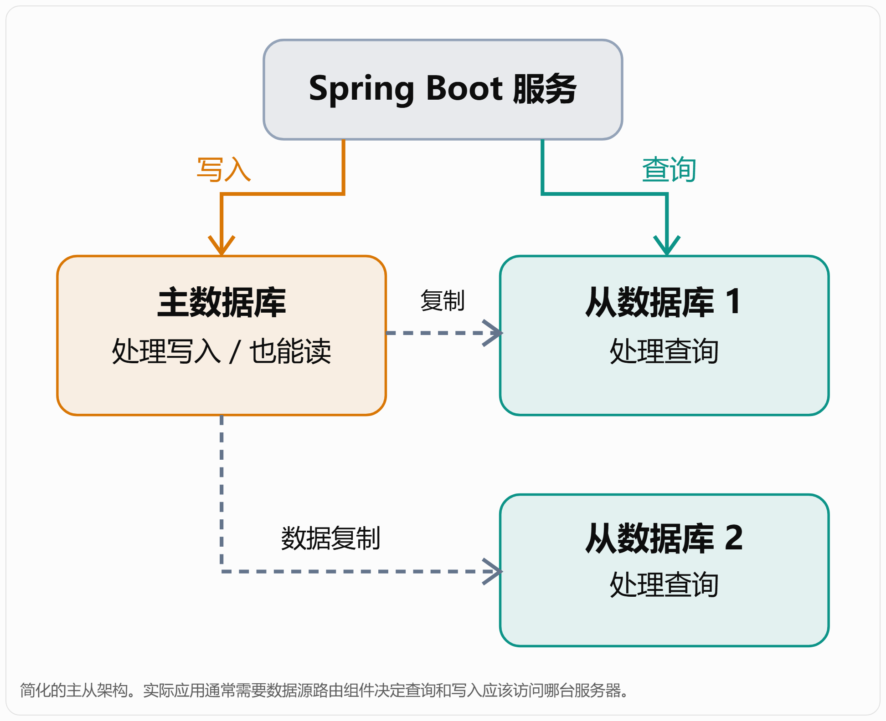

这两个概念放在一起学习很有价值。它们都在区分“读”和“写”，但解决的问题其实完全不同。

**读写锁解决的是并发访问的正确性与效率；数据库读写分离解决的是数据库的负载分配与扩展能力。**

我们先理解读写锁，再看数据库为什么要采用读写分离。

## **一、读写锁：为什么读取也需要加锁？**

先回到 Java 的 `synchronized`。

假设有一个配置对象，100 个线程需要读取它，只有 1 个线程偶尔修改它。

```
public synchronized String getName() {
    return name;
}
```

` synchronized` 可以保证安全，但它有一个问题：

即使所有线程都只是在读取 `name`，它们也必须逐个获取同一把锁。

可是，**如果没有线程修改数据，多个线程同时读取并不会相互干扰。**

于是就产生了读写锁（Read-Write Lock）。

### **1. 读写锁的规则**


在 Java 中，典型实现是 `ReentrantReadWriteLock`。它提供读锁和写锁：读锁是共享的，写锁是独占的。

Oracle Docs+1

### **2. 怎么使用？**

```
import java.util.concurrent.locks.ReentrantReadWriteLock;

class Config {
    private String name = "default";

    private final ReentrantReadWriteLock lock =
            new ReentrantReadWriteLock();

    public String getName() {
        lock.readLock().lock();
        try {
            return name;
        } finally {
            lock.readLock().unlock();
        }
    }

    public void setName(String newName) {
        lock.writeLock().lock();
        try {
            name = newName;
        } finally {
            lock.writeLock().unlock();
        }
    }
}
```

这里有几个关键细节。

首先，`readLock()` 和 `writeLock()` 虽然是两个接口，但属于同一个读写锁，因此可以互相协调。

其次，`finally` 负责保证方法异常退出时也能释放锁，防止其他线程一直等待。

最后，读写锁和 `synchronized` 一样，也具有内存同步保证。正确获取和释放锁可以建立相应的 happens-before 关系。

### **3. 读写锁一定比** `synchronized` **快吗？**

不一定。

读写锁需要维护读锁持有数量、写锁竞争等状态，管理成本可能高于普通互斥锁。

如果读取操作只是：

```
return count;
```

那么引入读写锁可能得不偿失。

但如果存在大量读取、少量修改，而且每次读取都要进行较复杂的操作，读写锁就可能体现优势。

它也有代价：大量读线程持续进入时，写线程可能等待较久，具体取决于锁的公平策略。

**所以读写锁的核心不是“读写分开就更快”，而是尽量减少不必要的互斥。**

## **二、数据库读写分离：为什么要把查询和修改放到不同服务器？**

现在我们换一个层次。

假设你开发了一个电商系统，只有一台 MySQL 数据库。

每秒收到：

* 9,000 次商品查询。
* 1,000 次订单、库存等写操作。

这些请求都发给同一个数据库。

随着用户增加，数据库的 CPU、磁盘 I/O、内存及连接处理能力可能逐渐成为瓶颈。

于是我们希望：

**既然大量请求只是查询数据，能不能增加数据库服务器，让它们分担查询压力？**

答案就是主从复制与读写分离。

### **1. 数据库读写分离的基本结构**



简化的主从架构。实际应用通常需要数据源路由组件决定查询和写入应该访问哪台服务器。

这里有一个很重要的问题：

**如果写操作都发生在主库，从库怎么知道主库的数据发生了变化？**

这就需要数据库复制（Replication）。

以 MySQL 常见的异步复制为例，主库提交事务后，相关变更记录通过二进制日志等机制传递给从库，从库再应用这些变更。

MySQL开发者专区+1

所以主库和从库维护的是同一份逻辑数据的不同副本。

但它们不一定在每个瞬间完全一致。

## **三、数据库读写分离也有“可见性问题”**

这里就能和你刚学的 Java 多线程形成联系了。

假设用户的账户余额是 100 元，现在存入 100 元。

一次写入后立即读取

| 时间     | 主数据库           | 从数据库           |
| -------- | ------------------ | ------------------ |
| 10:00:00 | 余额 100           | 余额 100           |
| 10:00:01 | 写入成功，余额 200 | 余额 100           |
| 10:00:02 | 余额 200           | 查询仍返回 100     |
| 10:00:03 | 余额 200           | 复制完成，余额 200 |

时间与延迟均为假设，仅用于说明异步复制产生的数据滞后。

用户明明已经收到“存款成功”，刷新页面却看到余额仍是 100。

这是为什么？

因为主库已经完成写入，但从库可能还没有完成复制。

这种现象叫作**复制延迟（Replication Lag）**。

它与 Java 普通字段的可见性问题有相似之处：一个执行主体已经完成修改，另一个读取主体却没有观察到新值。

但机制不同：

* Java 多线程：涉及共享内存、JMM 与线程同步。
* 数据库主从复制：涉及独立数据库副本之间的数据传播和复制进度。

这不是 `volatile` 或 `synchronized` 能解决的问题。

### **这种问题怎么解决？**

要看业务是否允许短暂读取旧数据。

例如商品浏览量、新闻阅读数，允许几秒延迟通常影响不大。

但是账户余额、订单支付状态、库存校验，就可能要求更强的一致性。

常见方案包括：关键查询走主库；一次写入后的相关查询暂时走主库；或者等待从库复制进度达到要求后再读取。

尤其要注意：**Spring 的** `@Transactional(readOnly = true)` **本身并不意味着查询会自动路由到从库**。读写路由还需要额外的数据源配置或代理组件。

## **四、两者到底有什么联系？**

从更抽象的角度看，它们确实都在处理：

**当读取和修改并发发生时，如何兼顾正确性与性能？**

但所处层次、采取的手段与需要牺牲的东西不一样。

| 对比维度   | Java 读写锁                                | 数据库读写分离                   |
| ---------- | ------------------------------------------ | -------------------------------- |
| 所属层次   | Java 线程并发控制                          | 数据库架构                       |
| 核心目标   | 安全访问共享状态，提升读并发               | 分担查询负载                     |
| 基本手段   | 读锁共享、写锁独占                         | 主库写入、从库查询               |
| 数据位置   | 通常是同一份内存数据                       | 多台服务器上的数据副本           |
| 一致性特点 | 正确加锁可以协调读写，避免读写交错破坏状态 | 异步复制可能读到旧数据           |
| 主要代价   | 锁管理、锁竞争和等待                       | 复制、数据延迟、路由及运维复杂度 |

有意思的是，数据库内部也会使用锁和多版本并发控制（MVCC）等技术管理并发访问。

例如 MySQL InnoDB 的普通一致性读取常常可以通过 MVCC 避免直接与写事务互斥；这并不等于它完全不需要锁，而是采用了更复杂的并发控制机制。

所以这两个领域并不是完全孤立的，它们都有一个共同的演进方向：

**从简单的互斥，发展到尽量减少不必要的互相等待。**

## **五、作为 Java 后端开发者，需要掌握到什么程度？**

对于 Java 读写锁，理解共享读、独占写、适用场景，并能看懂 `ReentrantReadWriteLock` 的基本用法就够了，不必现在研究内部队列实现。

对于数据库读写分离，知道为什么要复制数据、读请求怎样分流、为什么可能产生复制延迟，以及哪些业务不能容忍旧数据，就建立了必要的基础。

不过还有一个值得以后单独深入的问题：**既然数据库存在大量并发读写，为什么现代数据库不简单地依赖读写锁，而要引入事务隔离与 MVCC？**

它会把你现在的多线程知识，和后端开发中的事务、一致性、数据库并发控制连接起来。但我们不用因此打断 Java 多线程的主线。

**下一步可以回到线程协作与死锁。** 读写锁我们已经建立了基本认识，没必要现在展开所有锁的变种。
