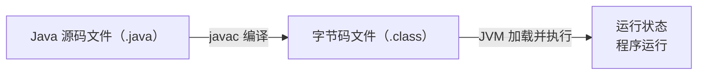
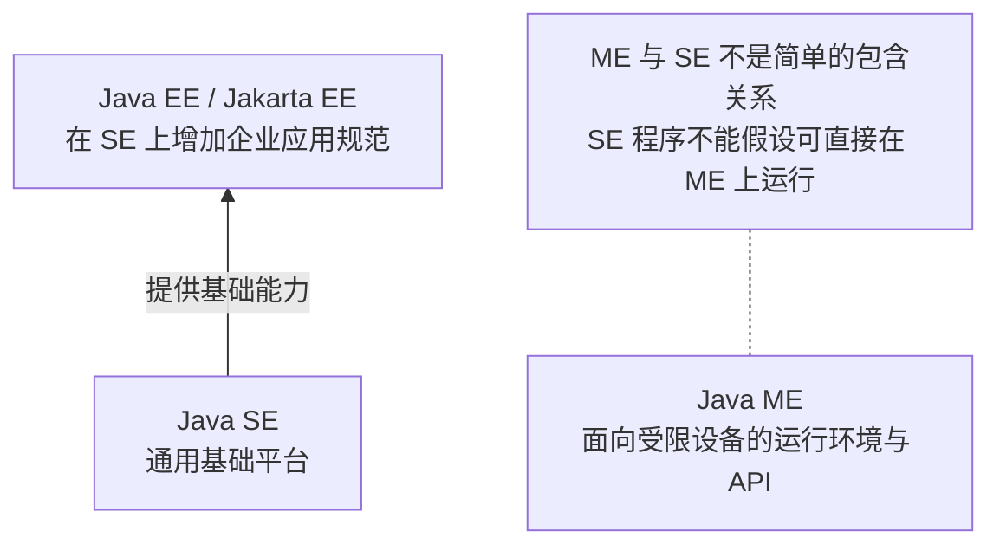

# Java 运行机制与平台边界

## 程序如何运行

Java 源码（`.java`）通常先编译为字节码（`.class`），再由 JVM 加载和执行。字节码通常不是 CPU 能直接执行的机器码。

同一份字节码可以在不同系统的兼容 JVM 上运行，平台差异由各自的 JVM 处理。但如果程序依赖特定系统的路径、命令或本地库，跨平台仍可能出问题。

## JDK、JRE、JVM 的职责

| 名词                   | 职责                                       |
| ---------------------- | ------------------------------------------ |
| JVM（Java 虚拟机）     | 加载、执行字节码                           |
| JRE（Java 运行环境）   | 提供 JVM 和运行所需的类库等                |
| JDK（Java 开发工具包） | 提供编译器、调试器等开发工具，以及运行能力 |

开发 Java 程序安装 JDK 即可。这组关系用于区分职责，具体发行包的目录不一定按这个层次组织。

## SE、EE、ME 的边界

| 平台    | 提供什么                                                          | 边界                                                                            |
| ------- | ----------------------------------------------------------------- | ------------------------------------------------------------------------------- |
| Java SE | 语言与通用基础能力，包括集合、文件、网络、多线程、JDBC 等         | 可用于命令行、桌面和服务器程序；不限定程序规模，但不统一规定完整的 Web 应用机制 |
| Java EE | 建立在 SE 上的企业应用规范，包括 Web 请求处理、持久化、事务管理等 | 需要具体软件实现规范；“企业应用”指需求类型，不是所有公司开发的软件            |
| Java ME | 面向资源受限设备的运行环境和 API                                  | 不能视为 SE 的简单子集，也不能假设 SE 程序可直接运行                            |

需要记住的几个区别：

- SE 已有网络通信和 JDBC；EE 在此基础上提供 Servlet、JPA、JTA 等更上层的规范。
- Java EE 后来延续为 Jakarta EE。Tomcat 实现 Servlet 等部分规范，不是完整 EE 平台的实现。
- Spring 是建立在 SE 上的独立框架生态，会使用或整合部分 EE 规范；学习后端不必先学完整套 EE。
- 嵌入式设备也可能运行 SE，取决于资源和系统支持；Android 有自己的运行环境和应用 API，不属于 ME。

参考：[廖雪峰《Java历史》](https://liaoxuefeng.com/books/java/quick-start/history/index.html)。其中将 SE、EE、ME 画成层层包含，容易误导；尤其 ME 与 SE 不能按简单包含关系理解。
